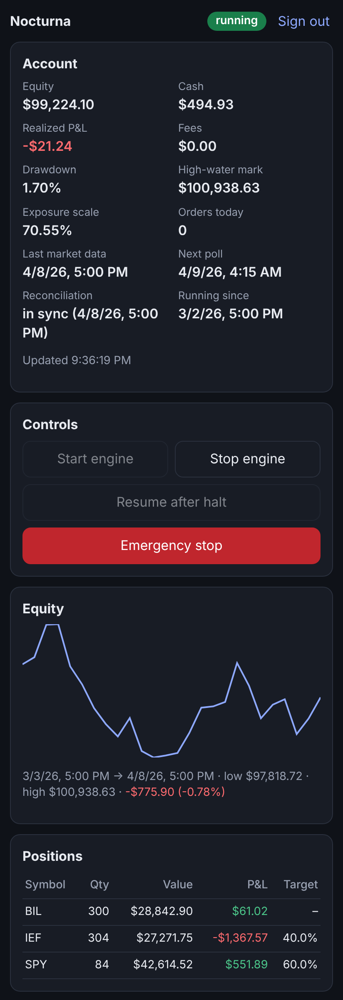
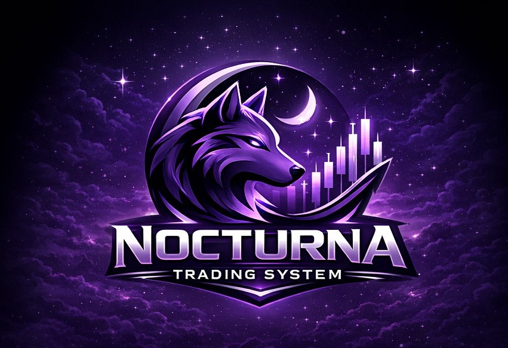

<div align="center">
  
  <p>
    <a href="https://github.com/Yog-Sotho/Nocturna-Trading-System/actions/workflows/ci.yml"></a>
    <a href="LICENSE"></a>
    
    
    
    
    <a href="https://github.com/sponsors/Yog-Sotho" target="_blank" rel="noopener"></a>
  </p>
</div>

# 🐺 NOCTURNA Trading System

**A trading robot that refuses to fool you.**<br>
Connect a free Alpaca paper account → it trades a calm stocks-and-bonds portfolio behind hard
safety limits → you watch it from your phone, and no "clever" strategy gets a cent until it
survives a gauntlet of tests built to catch lucky backtests.

> [!WARNING]
> **Paper trading only, on purpose.** Live trading is switched off in the code: the app won't
> start unless `TRADING_MODE=PAPER` and it points at Alpaca's paper API. No strategy here has
> passed out-of-sample validation, so none should be trusted with real money.

---

## 🤔 What is this?

Most trading bots you find online come with a gorgeous backtest: a line that goes up and to the
right forever. Then they meet the real market. 📉 The backtest was luck, tuned until it looked
good.

NOCTURNA is built the other way round. It's a self-hosted robot for one person that trades US
ETFs through [Alpaca](https://alpaca.markets), and it's paranoid by design:

- 🛡️ **Safety first.** Every order, from the robot or from you, passes one risk gate. If the
  account falls 10% below its peak, trading halts and every position is closed.
- 🧪 **No strategy on faith.** A new idea must survive walk-forward testing, a deflated Sharpe
  ratio, an overfitting test and triple trading costs before it may trade. So far none has, so
  the robot sticks to a plain 60/40 portfolio.
- 💵 **Idle cash works.** Whatever the safety rules leave unused sits in T-bills (BIL), not in
  cash earning nothing.
- 📱 **It lives in your pocket.** A phone-first dashboard and a Telegram bot: check positions,
  start, stop, or hit the emergency stop from anywhere.
- 🏠 **It runs at home, 24/7.** One setup script turns an Ubuntu machine into the robot's home:
  Docker, daily backups, alerts, and a dead man's switch that tells you if it ever goes quiet.
- 🔒 **Paper only.** Real-money trading is disabled in the code itself.

No finance degree required. If you can copy-paste a few commands and use a phone, you can run it.

---

## 🖼️ Gallery

<div align="center">
  
  <p><em>The dashboard on a desktop: the account, its safety figures, the controls, the equity
  curve and what the robot holds.</em></p>
  
  &nbsp;
  
  <p><em>On your phone, in dark mode, and the emergency stop: one tap halts everything and asks
  whether to keep the positions or close them. If the robot doesn't answer, Alpaca is asked
  directly.</em></p>
  <p><sub>Screenshots from the built-in simulator, with made-up prices, not a real account.</sub></p>
</div>

---

## 📊 The honest scoreboard

Every idea below follows its published rules (the three newest had theirs written down
*before* their first backtest) and went through the same tests. The verdicts come from the
years the tests held back, January 2020 to October 2026, which a strategy never sees while it
is being chosen:

| Idea | Verdict | In plain English |
|---|---|---|
| 🥧 60/40 stocks and bonds (`benchmark`) | ✅ Trades on paper, as the yardstick | 6.3% a year, worst drop −12%. Tested back to 1974 on free data: 8.1% a year, worst drop −15%, five kill-switch stops in 52 years |
| 🔁 Front-running pension rebalancing (`rebalancing`) | ❌ Rejected | The edge shows up between closes and vanishes by the next morning's open. It would also churn the portfolio about 43 times a year |
| 📈 Trend following on 12 ETFs (`tsmom`) | ❌ Rejected | Too weak out of sample |
| 🪙 Crypto breakouts (`crypto-trend`) | ❌ Rejected | Too weak out of sample (2024 to 2026: Alpaca's crypto data starts in 2021) |
| 🧩 The three above, combined (`lineup`) | ❌ Rejected | Didn't beat the plain 60/40 |
| 📅 Month-end payment cycle (`month-end`) | ❌ Rejected | 21.4% in almost seven years, against T-bills' 20.3% |
| 🌊 Trend filter on the 60/40 (`trend-filter`) | ❌ Rejected | A tie with the 60/40 since 2017, a little behind it since 1974. It did hit the kill switch only twice in 52 years, against five times |
| 🐢 Low-volatility funds instead of SPY (`low-vol`) | ❌ Rejected | 3.6% a year, against the 60/40's 6.3% |

<sub>The 60/40 row is the live portfolio, held at 60/40. The rejected ideas were compared with the
60/40 validated the same way they were, with its stock weight (40–80%) re-chosen each year;
that earned about the same, 6.3% a year since 2020 and 8.2% since 1974.</sub>

Seven rejections out of seven isn't the robot failing. It's the robot doing its job. 🐺 The
numbers, sources and reasoning are in the [strategy shortlist](docs/STRATEGY_SHORTLIST.md) and
the [roadmap](docs/ROADMAP.md).

---

## 🚀 Get started in 3 steps

### 1. Get a free paper account

Sign up at [Alpaca](https://alpaca.markets) and create **paper trading** API keys. Play money
only: NOCTURNA won't start with anything else.

### 2. Set it up on a home server (recommended)

On an Ubuntu machine:

```bash
git clone https://github.com/Yog-Sotho/Nocturna-Trading-System.git
cd Nocturna-Trading-System
sudo ./setup.sh --check    # only looks: what's installed, and what it would change
sudo ./setup.sh            # lists the changes first, then asks before making them
```

The setup installs what's missing (Docker, Compose, Tailscale) and puts the dashboard on a
private Tailscale address. It writes your `.env`, asking only for what only you know, like your
Alpaca keys. Then it starts everything, creates your dashboard login and sends a test alert. It
never adds anyone to the `docker` group, and never touches what Tailscale already serves.

The step-by-step guide, with every setting explained, is [HOME_SERVER.md](docs/HOME_SERVER.md).

### 3. Start the robot

Open the dashboard on your phone → **Start engine** → confirm. Or send `/start_engine` to your
Telegram bot, then the `/confirm` code it replies with.

From then on it wakes up each time a new daily bar is final, works out what to hold, and trades
at the next opening auction.

### Just want to look around first? 👀

Try the real dashboard on a simulated robot with made-up prices. No account, no keys:

```bash
git clone https://github.com/Yog-Sotho/Nocturna-Trading-System.git
cd Nocturna-Trading-System
python3 -m venv .venv && source .venv/bin/activate    # Python 3.13 or newer
pip install -r requirements.txt
python tools/dashboard/serve_sim.py . /tmp/dashboard.db 5055
```

Open <http://127.0.0.1:5055> and sign in as `ops` / `Harness-Passw0rd!`. Start the engine and
one simulated trading day passes every three seconds.

---

## 🧰 "I want to…" cheat sheet

| I want to… | On the dashboard | In Telegram |
|---|---|---|
| see how it's doing | the **Account** card | `/status` |
| see what it holds | **Positions** | `/positions` |
| start or stop the robot | **Start engine** / **Stop engine** | `/start_engine` / `/stop_engine` |
| stop trading now, keep my positions | **Emergency stop** → *Keep the positions* | `/halt` |
| stop trading now and sell everything | **Emergency stop** → *Close every position too* | `/flatten` |
| carry on after a halt | **Resume after halt** | `/resume` |

Every Telegram command that changes something asks for a `/confirm <code>` first, so a stray
tap does nothing.

On the server (put `sudo docker compose exec api` in front of each):

| I want to… | Run this |
|---|---|
| check paper trading against a backtest of the same days | `flask --app src.main soak report` |
| test a strategy idea on Alpaca data | `flask --app src.main validate benchmark --start 2017-01-01` |
| test it on free data back to 1970 | `flask --app src.main validate benchmark --data history --start 1971-01-01 --end 2026-08-31` |
| make sure my alerts arrive | `flask --app src.main send-test-alert` |

And on the machine itself, `sudo ./setup.sh --check` reports what's installed and configured,
without changing anything.

---

## 🛡️ The safety limits

These are the defaults, all as fractions of the account's value. You can change them in `.env`,
and they apply the same way in backtests and on paper:

| Limit | Default |
|---|---|
| Kill switch: halt and close every position | 10% below the account's peak |
| Shrink exposure gradually as losses grow (down to 25% at the kill switch) | from 5% below the peak |
| Daily loss limit: no new risk for the rest of the day | 3% |
| Volatility target (scales down only, never borrows) | 8% a year |
| Largest position / all crypto together / everything together | 60% / 15% / 100% |
| Largest single order (fat-finger guard) | 60% |
| Limit prices more than this far from the last close are refused | 5% |
| The same order twice within 5 minutes | refused |
| Orders / turnover per day | 50 / 2× the account |
| Market data older than / a one-bar jump bigger than | stocks 5 days / 25%, crypto 2 days / 50% |
| Positions are adjusted only when this far from target | 2% |
| Idle cash | in T-bills (BIL), less a 0.5% buffer |

Orders that only shrink a position are always allowed, so the book can always be reduced. A halt
is saved in the database, so it survives a restart. The fine print is in the
[technical reference](docs/REFERENCE.md#risk-controls).

---

## 🧪 How a strategy earns the right to trade

Run `flask validate` on any idea and the robot puts it through this gauntlet, with the same
engine, costs and safety limits as paper trading:

| Test | What it catches | To pass |
|---|---|---|
| **Walk-forward** | Ideas that only work on the data they were tuned on | Return per unit of risk above T-bills (Sharpe) of at least 1.0, on years held back |
| **Deflated Sharpe** | A "best result" that is just the luckiest of many tries | At least 0.95 |
| **Overfitting test** | Settings that look best in-sample and flop out of sample | At most a 20% chance |
| **Triple costs** | An edge that trading costs would eat | Still beats T-bills |
| **Neighbours** | A lucky spot in the settings | Nearby settings at least half as good |
| **Worst drop** | Risk beyond the safety limits | No more than 12% |
| **Paper soak** | A backtest the real market doesn't confirm | 60 trading days tracking the backtest |

It writes a full report and ends with its verdict: *rejected*, naming the tests it failed, or
*eligible for paper trading*. How each test works is in the
[technical reference](docs/REFERENCE.md#validating-a-strategy).

---

## 🔐 Your money and your keys stay yours

Everything runs on your own machine. Your Alpaca keys live in your `.env` and go only to Alpaca.
With the home-server setup, the dashboard is reachable only through your private Tailscale
network, and it has one operator account: yours, with public sign-ups switched off. The free long-history data (Kenneth French's
data library and FRED) is downloaded only when you ask for it.

---

## 🗺️ What's been built, what's coming

**Already available:**
- ✅ One trading core: the same code in backtests and on paper
- ✅ Risk gate, kill switch, daily loss limit, volatility target and the drawdown ladder
- ✅ Validation gauntlet: walk-forward, deflated Sharpe, overfitting tests, cost stress
- ✅ Long-history tests on free data back to 1970
- ✅ Idle cash in T-bills
- ✅ Phone-first dashboard, light and dark
- ✅ Telegram commands with confirmation codes
- ✅ Alerts (Telegram, ntfy, webhook) and a dead man's switch
- ✅ Home-server setup with Docker Compose, daily backups and an optional HTTPS proxy
- ✅ Versioned REST API with an OpenAPI 3.1 document
- ✅ Over 800 automated tests, strict typing on the trading core, mutation testing of the risk code

**Coming next:**
- ⏳ A 60-day paper soak on a real paper account, measured against its backtest
- ⏳ Only after that, and only for a strategy that passes every test: a staged move to real money

---

## 🤓 For the nerds

| Guide | What you'll find |
|---|---|
| [Technical reference](docs/REFERENCE.md) | Every component, the API, every setting, development and CI |
| [Architecture](docs/ARCHITECTURE.md) | How the engine, risk gate, sizing and validation fit together |
| [Home server](docs/HOME_SERVER.md) | Setting up the machine, step by step |
| [Runbook](docs/RUNBOOK.md) | Alerts, upgrades, incidents, backups and restores |
| [Roadmap](docs/ROADMAP.md) | The plan, the decisions and the promotion gates |
| [Strategy shortlist](docs/STRATEGY_SHORTLIST.md) | Every idea tested, its sources, its rules and its result |

---

## 🤝 Contributing

Contributions welcome! Fork the repo, make your change, and run the checks before opening a pull
request:

```bash
pip install --require-hashes -r requirements-dev.txt
pytest src/tests && ruff check src/ tools/ setup/ && mypy
```

Found a bug? [Open an issue](https://github.com/Yog-Sotho/Nocturna-Trading-System/issues) with
what you ran and the full error message.

---

## 📜 License

MIT: free to use, change and share. See [LICENSE](LICENSE).

## ⚠️ Disclaimer

This software is provided as-is, without warranty. Trading involves a substantial risk of loss.
Nothing in this repository is investment advice.

---

<div align="center">
  

  **Made with ❤️, caffeine and a healthy distrust of backtests.**

  *If NOCTURNA saved you from a strategy that only worked on paper, a ⭐ on GitHub means the world.*<br>
  Yog-Sotho
</div>
