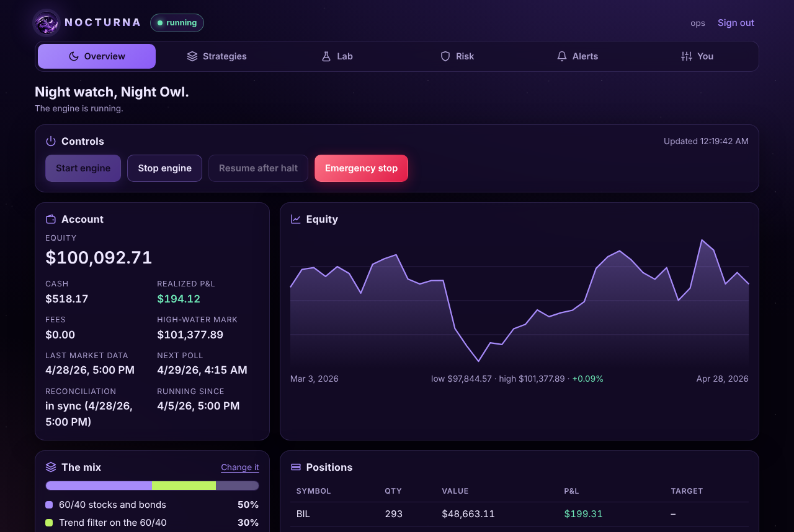
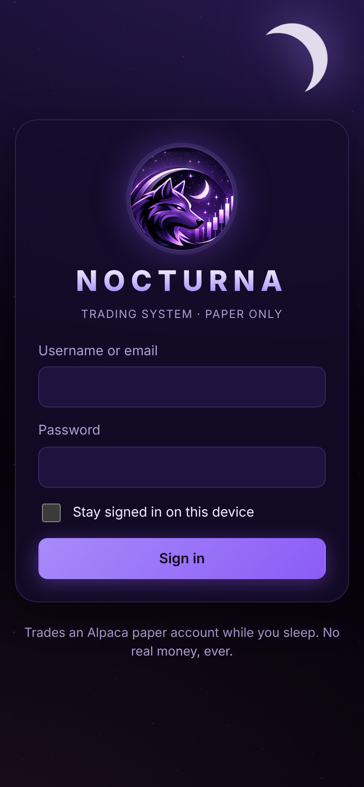
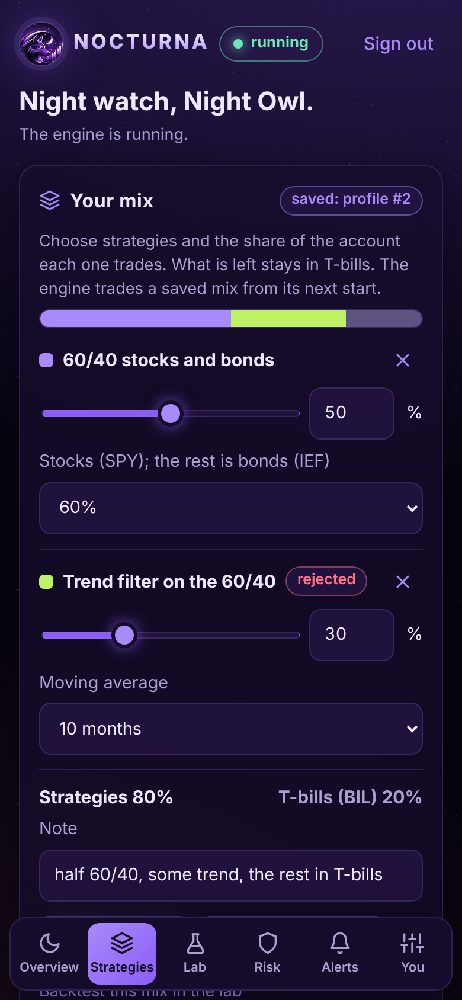
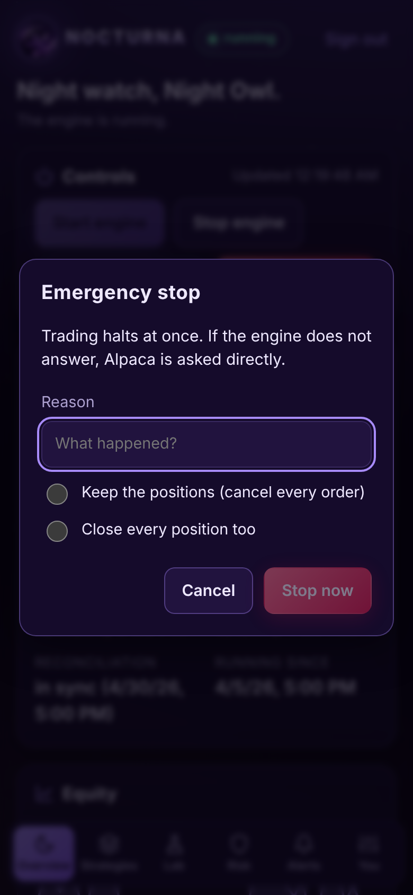
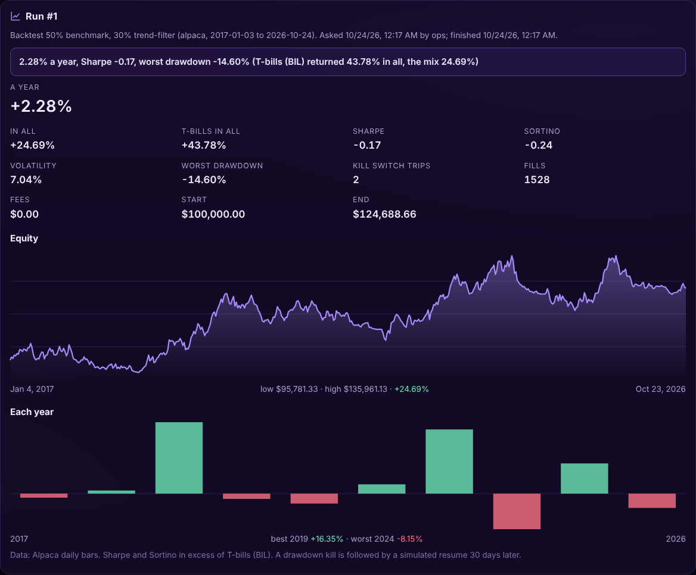

# 🐺 NOCTURNA Trading System

**A trading robot that refuses to fool you.** 
Connect a free Alpaca paper account → it trades a calm stocks-and-bonds portfolio behind hard
safety limits → you watch it from your phone, and no "clever" strategy gets a cent until it
survives a gauntlet of tests built to catch lucky backtests.

!!! warning "Paper trading only, on purpose"
    Live trading is switched off in the code: the app won't start unless `TRADING_MODE=PAPER`
    and it points at Alpaca's paper API. No strategy here has passed out-of-sample validation,
    so none should be trusted with real money.

## 🤔 What is this?

Most trading bots you find online come with a gorgeous backtest: a line that goes up and to the
right forever. Then they meet the real market. 📉 The backtest was luck, tuned until it looked
good.

NOCTURNA is built the other way round. It's a self-hosted robot for one person that trades US
ETFs through [Alpaca](https://alpaca.markets), and it's paranoid by design:

- 🛡️ **Safety first.** Every order, from the robot or from you, passes one risk gate. If the
  account falls 10% below its peak, trading halts and every position is closed.
- 🧪 **No strategy on faith.** A new idea must survive walk-forward testing, a deflated Sharpe
  ratio, an overfitting test and triple trading costs before it may trade.
- 💵 **Idle cash works.** Whatever the safety rules leave unused sits in T-bills (BIL).
- 🎛️ **You choose what trades.** Pick strategies and their shares, tune the risk limits inside
  hard bounds, and backtest or validate a mix in the dashboard's strategy lab first.
- 📱 **It lives in your pocket.** A phone-first dashboard in a night theme, and a Telegram bot.
- 🏠 **It runs at home, 24/7.** One setup script, Docker, daily backups, alerts and a dead
  man's switch.

## 🚀 Where to start

| I want to… | Read this |
|---|---|
| set it up on a home server, step by step | [Home server](HOME_SERVER.md) |
| look after it once it runs: alerts, upgrades, incidents, backups | [Runbook](RUNBOOK.md) |
| know every setting, the API and the safety limits in full | [Technical reference](REFERENCE.md) |
| understand how the engine, risk gate and validation fit together | [Architecture](ARCHITECTURE.md) |
| see the plan and why each decision was made | [Roadmap](ROADMAP.md) |
| see every strategy idea tested, with its sources and its result | [Strategy shortlist](STRATEGY_SHORTLIST.md) |

## 🖼️ The dashboard

{ width="750" }

{ width="240" }
{ width="240" }
{ width="240" }

{ width="750" }

*Screenshots from the built-in simulator, with made-up prices, not a real account.*

## 📜 License

MIT: free to use, change and share. The code lives at
[github.com/Yog-Sotho/Nocturna-Trading-System](https://github.com/Yog-Sotho/Nocturna-Trading-System).

Trading involves a substantial risk of loss. Nothing on this site is investment advice.
